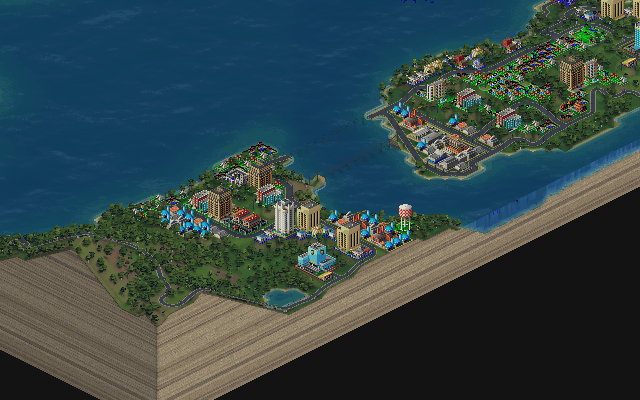
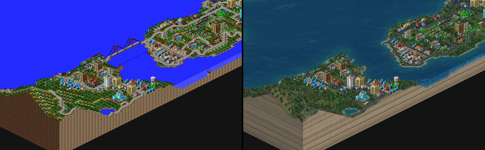
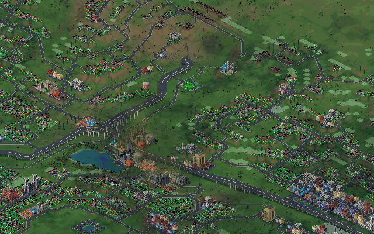

# Arcology

A from-scratch reconstruction of the SimCity 2000 simulation engine, verified against the original Mac 68k binary (my
favourite version), with a modern renderer and multi-city regions.

Not a remake and not an emulator. The simulation is C, rebuilt one routine at a time by reading Motorola 68000 out of
the retail Macintosh release and checking every pass against the original's own code running under an interpreter. Where
the two disagree, the original is right.



*Bayview, running. The simulation is the reconstruction; the terrain is the new renderer.*

### The old renderer and the new one



Same city, same frame, same simulation underneath. On the left is the original's own terrain and water art, drawn from
the atlas the 1995 build drew from -- flat tiles and a repeating water pattern. On the right is the terrain mesh and the
water shader: real lighting on the ground, depth in the water, and the geological strata the map's altitude data implied
all along and the sprites had no way to show.

Both are always available -- ⇧⌘T (Geometry, in the view menu) switches between them while the game runs, and
`--look sprites`, `--look geometry` or `--look mesh` (the mesh with nothing standing on it) picks one for a run. A window
opens on geometry, and so does a run with no window: a headless run is the same frame with no interface on it.
Only `--compare-renderers` draws sprites by default, since the software renderer it checks against draws nothing else. The sprite path is not a legacy mode: the software rasteriser draws it pixel-exact against the
original's frame, and `--compare-renderers` shows where the GPU frame parts from it.

### The sky



Oakland, the camera drawing back and coming in again. The clouds are the cities' own weather: the cloud cover the
simulation keeps for its solar plants and water pumps sets how much of the sky is under cloud, so a clear city has a
clear sky. They show whole from half the art's size outward and clear as the camera comes in, and their shadows fall
on the ground, the water and the buildings at every zoom. The air pass under them adds the haze, the smog and the
scattered light.

These images are generated from the current build by `cmake --build build --target showcase`. If they look out of date,
they are -- regenerate them.

---

## Where it stands

The whole 25-phase monthly clock runs, and it runs *exactly*: over six shipped cities, a full month each,

| | |
|---|---|
| map layers | **335928 / 335928** live cells |
| scalars | **5760 / 5760** |
| random draws | **6 / 6** cities identical, draw for draw |

Each pass is also checked on its own against the original's code running under the interpreter:

| | |
|---|---|
| a whole 16-phase growth cycle | **18 / 18** cities, every byte of six layers |
| the random stream over a cycle | **589,426** draws, all seven generators, in order |
| moving objects, fifty frames | **17 / 17** cities, all forty records |
| disasters | **14 / 14** kinds, five starting points each |
| the economy | **18 / 18** cities, all 63 quantities |

Across every readable city in the collection, the six data layers -- pollution, land value, density, police, fire and
crime -- match on every live cell. All fourteen disasters reproduce tile for tile, and the year-end pass over every
special building on the map -- power plants ageing toward failure, the prisons that set the police radius, the
arcologies -- is exact on every record. The figures, and what each one proves, are in `docs/sc2k-report.rst`.

"Draw for draw" is the standard that matters. The simulation consumes three random generators, and reproducing
the *sequence* of draws means the reconstruction is taking the same branches as the original, not merely arriving at a
similar answer.

## What Arcology adds

The reconstruction is the baseline, and everything below is built on top of it. None of it changes what the
simulation computes.

**A 3D world drawn from the city's own data.**
- The terrain is a lit mesh. It is drawn on the grid between tile centres, so slopes run smoothly from tile to tile.
  Cliffs lean and break, and every cut shows the rock strata.
- The water is a shader with depth and a lit surface, and the shore is coloured by its distance from the water.
- The camera turns freely or by quarters (`,` `.` `q` `e`) and tilts anywhere from 30 to 90 degrees. It zooms
  continuously, and the map view (⇧⌘N) looks straight down, north up.
- The sun follows the time of day (View > Time of day, dawn to night). It casts shadows, lights the ground, and
  darkens the creases with ambient occlusion.
- The clouds come from the cities' weather and cast shadows on everything under them. The air pass adds haze, smog
  and scattered light (View > Clouds, View > Air).
- The trees are 3D. Their species follow a biome, picked from the city's place or from View > Trees. They sway in the
  wind and are simplified at a distance.
- The building sprites are the original's and stand in for 3D buildings.

**A road network, derived from the cells.**
- Every road, railway, highway, ramp, sidewalk and crosswalk is a record of one road network, in the structure of
  ASAM OpenDRIVE. It is derived in C from the simulation's tiles and the street layer, and `--net-check` holds every
  lane of every shipped city to the check that it continues and is fed.
- The street layer is player data the original never had. Each street has a class (street, avenue or boulevard) and
  a direction (two-way, or one-way either way). An import infers both once, from the population and traffic along the
  street.
- The mesh draws the streets with their junctions, sidewalks, crosswalks and dead ends. It draws the railways with
  their turnouts and buffer stops, and the level crossings between the two. A highway is a deck on columns, kept clear
  of the roads below, and a highway's interchange is routed as separate one-lane ramps on up to three levels.
- ⇧⌘O lays the lane graph over the ground, and `--net-svg FILE` writes it as a diagram.

**Editing, live.**
- The bulldozer's Demolish and Raise and the network fitters are reconstructions held to the original. The zones,
  the ports and De-zone are offered inside the city's limits.
- An edit rebuilds only the blocks of the world it touches. The rebuild runs on its own thread, and the pieces it
  changes sink away and rise back as a wave out from the edited tiles.
- The window builds a large world a block at a time, nearest the camera first, and the land settles in as it comes.

**Worlds, not saves.**
- `.arco` holds a chunked world of one or more cities (below), and `--compose` places several cities in one world.
- A city's limits follow what it has built, and with `--limits-glow N` the clock reads and writes only inside them.

**The tools to look inside.**
- The inspector (⇧⌘I) names the road record under the pointer, and outlines its lanes, its structure and its
  junctions. A remark typed into it is filed with the records and the camera.
- `--mesh-check` proves the world's mesh is watertight. The Tuning window moves the numbers the world is built
  from, the Shading window moves the light, and the Renderer stats window shows what a frame costs.
- The interface wears Kaleidoscope themes, and the music is the original's own songs and instruments.

## Work in progress

Each area has a plan in `plans/`, and its status page or `TODO.md` lists what is open.

- **Drawing the road network** (`plans/network.md`, `plans/network-status.md`, `plans/drawing.md`,
  `plans/interchanges.md`). The street leading onto a bridge is drawn, but the bridge's span,
  tunnels, a turn from one kind of way onto another, and the interchanges the router does not lay out have no drawing. The 3D view hides the original's art on every tile
  the network runs over, so each of these shows as a gap. Nothing drives on the drawn roads, and a junction's signals
  and stop signs are filed but unread. A staircase of road cells drawn as a clean diagonal, and buildings that give
  way to a highway's ramps, are the design's.
- **The player's tools** (`TODO.md`). The bulldozer's Level and Lower; placing power plants, pumps, schools, parks and
  rewards; the line tools for roads, rails, power, pipes, subways, bridges, highways, tunnels and on-ramps; trees,
  water, the terrain editor and signs; the line preview and the tool cursors.
- **A much larger region** (`plans/limits.md`, `plans/terrain.md`). Heights past the 32 levels a 1995 save holds,
  stored in the `.arco`. A region generated from a seed and a few sliders, shown as a map to pick a site from, with the
  original's own generator ported beside it. Chunks streamed in and out, and a renderer that reads a city's limits.
- **Cities that meet** (`plans/limits.md`). Independent cities in one region whose limits touch and, if the player
  wants, grow into each other, each placed in any of four orientations.
- **Saving the whole city.** A saved world keeps its layers and most of its scalars, but not its date, funds,
  population or bonds. Porting the original's MISC builder whole closes that gap.

## Building

```
cmake -B build
cmake --build build
./build/arcology
```

SDL3 is found if installed, or fetched with `-DARC_FETCH_SDL3=ON`. Dear ImGui is fetched at configure time, and so is spdlog.

Without SDL3 the same binary is built without the game in it: the developer modes still work, which is what the checkers in `tools/` drive. `-DARC_WERROR=ON` makes every compiler warning an error, as continuous integration builds it.

To run the verification suite you need your own copy of the game. `ARC_CITIES` is the one name it is read by: the build takes it, and so do the tools and the program.

```
cmake -B build -DARC_CITIES="/path/to/SimCity 2000 Collection"
ctest --test-dir build
```

## Running

```
arcology                       the load menu
arcology bayview               open a city from cities/, or give a path
arcology --verify <dir>        the verification report
arcology --clock <city> 25 <out>   one month, dumped for comparison
arcology --convert a.sc2 b.arco    a 1995 save becomes a world
arcology bayview --shot out.png    one frame to a PNG, no window
arcology bayview --shot out.png --hour 17.6 --trees boreal   at dusk, in a boreal forest
```

`arcology --help` lists the game's options and the developer switches, and `arcology --modes` the developer modes.

Every letter shortcut takes the platform's command key -- ⌘ on the Mac, Ctrl elsewhere -- and the menus show which.
The original's own shortcuts keep its letters (⌘L load, ⌘S save, ⌘Q quit, ⌘B budget, ⌘C population, ⌘G graphs); the
port's view switches add shift (⇧⌘T geometry, ⇧⌘N the map view, ⇧⌘U underground, ⇧⌘P screenshot, ⇧⌘G the tile grid,
⇧⌘O the road network's lane graph, ⇧⌘W the mesh's triangles, ⇧⌘M drawing in list order with no depth test, ⇧⌘I the
inspector, ⌘V and ⇧⌘V through the data views). A key and its menu item run one command, from one table
(`src/ui/commands.c`). The bare keys are game controls, not menu shortcuts: 1 to 5 for the speeds, space to pause, + and
- to zoom, [ and ] for the pixel scale, the arrows or WASD to scroll, `,` `.` `q` `e` to turn the camera and 0 to snap
it back. The mouse wheel zooms and a drag moves the map.

### Music

The Macintosh original carries its own music engine, Steve Hales' SoundMusicSys ("MIDI Synth 3.87" in its `MDRV`
resource): every song is a `MIDI` resource, every instrument an `INST` naming an `snd ` sample, and a `SONG` per song says
which instrument each MIDI channel plays. Arcology plays that data back with a small sample-based player of its own,
following the engine's rules as read from its BSD descendant, miniBAE: the channel is the instrument, a note is its sample
resampled from the root key at the engine's reference rate, looped while held where the sample loops. The songs start on
the original's own schedule, read from its code: a random pick among nine songs, never one of the last four, with a fixed
per-song wait that leaves anything from no silence to nearly two minutes between songs. Options > Music switches it and
the choice is kept with the theme in `settings.json`. `arcology --song 10018 theme.wav` renders a song headless.

Like the art, none of it ships: `tools/import_assets.py` reads the songs, instruments and samples out of your own copy
into `assets/music` and `assets/sounds`.

## Importing the game's resources

Arcology ships no art, no sound and no interface graphics. All of it is read out of a real, Macintosh SimCity 2000
installation, so the first thing to do after building is import it:

```
python3 tools/import_assets.py "/path/to/SimCity 2000 Collection"
```

That writes `assets/` and takes a few seconds. Then `./build/arcology` works.

### What it is doing

The game keeps everything in the **resource fork** of its application file -- a second data stream classic Mac OS
attached to every file. On macOS the fork is still there and the script finds it by itself. On Linux or Windows you need
it as a separate file first (a `.rsrc` beside the application, or extracted with `unar`), and then:

```
python3 tools/import_assets.py --rsrc path/to/sc2k.rsrc
```

These steps run in turn, and each can be run on its own:

| resource | tool | what comes out |
|---|---|---|
| `SHAP` | `tools/artpack.py extract` | `tiles8/16/32.png` + JSON -- the map art, 500 tiles at three zooms |
| `SHAP` | `tools/artpack.py split` | `split8/16/32/NNNN.png` + a Tiled `.tsx` -- every sprite in a file of its own |
| `PICT` | `tools/pict.py --atlas` | `ui.png` + `ui.json` -- the interface graphics |
| `snd ` | `tools/snd.py` | `sounds/*.wav` -- the effects |
| `MIDI`, `INST`, `SONG` | `tools/music.py` | `music/` -- the songs and their instruments |

The tile art is stored interleaved in a MIFF container as ids *N*, *N*+500 and *N*+1000, one per zoom. `artpack.py`
unpacks that into ordinary palette-indexed PNGs with JSON sidecars, so you can open the game's art in any image editor,
change it, and the game will load what you saved. `artpack.py verify` checks that a pack round-trips.

Nothing in the import needs anything outside the Python standard library.

### Kaleidoscope themes

The interface can wear a **Kaleidoscope** scheme -- the classic Mac OS theming format from the late nineties. Point
`tools/scheme.py` at a scheme's resource fork and it becomes a theme pack:

```
python3 tools/scheme.py path/to/scheme.rsrc assets/themes/NAME
```

`classic7`, Apple's System 7 look, is worn by default. **Options > Theme** lists every pack under `assets/themes/` and
None; a choice is remembered in `settings.json` in the per-user settings folder (Application Support on macOS, AppData on
Windows, `~/.local/share` on Linux) and comes back next run. `--theme NAME`, `--theme DIR` or `--theme none` overrides it
for one run.

Window frames, buttons, scroll bars, menu bars and title bars all come from the scheme, so a Kaleidoscope scheme written
in 1998 for a completely different program themes Arcology.

### Cities

The repository carries the collection's cities under `cities/`, lowercased with a `.sc2` extension, so
`arcology bayview` works from a fresh clone with nothing else set up.

Cities load from `.SC2` files -- the ones the game shipped, and any made since. A `.sc2` is only ever loaded: a world
is saved as `.arco`.

## The `.arco` format

The 1995 save is an IFF file: big-endian chunks, a bespoke run-length codec, a 4800-byte block of unnamed longs, and a
map that is 128x128 because the code says so. Arcology reads it exactly and always will -- it is the import path and
the reference baseline. It never writes one, and it is not a format to build a bigger game on.

`.arco` is that format, and it is **a ZIP archive**. That one decision buys most of what a modern format needs:

```
$ unzip -l bayview.arco
   world.json               dimensions, chunk size, the city list
   cities/0.json            treasury, budget, indicators
   cities/0/misc.bin        the state that has not been named yet
   cities/0/graphs.bin      sixteen series, 52 samples each
   chunks/0_0/altm.bin      terrain altitude, 16-bit little-endian
   chunks/0_0/xbld.bin      buildings
   chunks/0_0/street.bin    the player's street data, written only where the city has it
   ...
```

The manifest is JSON you can read, diff and hand-edit. The grids stay binary, because a 512x512 array of bytes has no
business being ASCII, and deflate beats the original's RLE on them anyway. A new feature adds a *file*, and a reader
that does not know that file ignores it -- there is no chunk registry to coordinate.

Three things it can express that the original cannot, and they are why it exists:

- **The world is chunked and unbounded.** Chunk size lives in the manifest, not in the code. An imported save is a
  128x128 patch written into whatever chunks it spans, and nothing about it has to stay 128 afterwards.
- **A city is a mask, not a rectangle.** Ownership is per tile, so a city's limits can follow its development and two
  cities can meet.
- **The format can hold an altitude of 16 bits, unclamped.** The one-level-step rule is the original's; the faithful mode keeps it and the
  enhanced mode does not.

Converting a save to a world:

```
arcology --convert bayview.sc2 bayview.arco
```

The game opens either without being told which is which.  A save made at a turn of the view other than the first has
its zone corner bits decoded into the grid's own terms as it is loaded, so the world holds no rotation.  Anything the
reconstruction does not name rides along in `misc.bin`, so naming a field later changes the manifest, never what a
file can hold.

## Layout

The renderer is C, and every number it builds the world from is set in C. The road network is derived in C from
the city's cells, and each road is given its shape in C. How it is drawn is
`plans/drawing.md`, and what is drawn is `plans/network-status.md`.

```
src/sim/         the simulation, C99, one routine of the original at a time; sim.c is
                 the clock, sim_scan.c, sim_growth.c, sim_map.c, sim_place.c, sim_thing.c,
                 sim_disaster.c and sim_micro.c the phases it calls, sim_queue.c the ring
                 they share; generated/tables.c the original's data
src/cells/       the city's cells as the network and the renderer read them: city.c the view,
                 adapt.c the view filled from the simulation, terrain.c what a terrain byte means
src/render/      the renderer: build.c runs a build, compose.c composes it, incr.c redoes what an
                 edit needs, show.c shows an edit's pieces going and coming, geo.c holds every
                 number the world is built from, turn.c the view from another side, shore.c and
                 trees.c the shore and the trees
  draw/          the drawing: roads.c, rails.c and bands.c lay the shaped network as surfaces;
                 net_graph.c lays out the lane graph and net_overlay.c draws it over the ground
  mesh/          every shape primitive: the emitter, the slab, the shape table, the polygon, the checks
  soft/          the original's own sprite renderer, address by address
  gpu/           the device and the frame, with the shaders under gpu/shaders/
  atlas/         the sprite atlas the software and GPU paths share
src/network/     the road network: topology.c (layer 1), network.c (layer 2), shape.c (layer 3), bank.c, street.c
src/dev/         the developer modes; net_svg.c writes the lane diagram (--net-svg), area_report.c
                 the debug report of an area, testcity.c a city of every network case
src/app/         the composition layer: options, the loop, the clock, the world, the UI glue
src/ui/          Dear ImGui behind a C interface (ui.h), with a no-op build (ui_none.c): ui.cpp the
                 art, the chrome and the controls, palette.cpp, menubar.cpp, windows.cpp, and
                 inspect.cpp the inspector
src/audio/       the sound effects and the music
src/util/        the log, the option table, the dump, the small filesystem helpers
src/vendor/      lodepng, CLI11, jsmn, Clipper2 and earcut
cities/          the collection, lowercase .sc2
tools/           the 68k interpreter, the oracle and the checkers
tests/           the music check
docs/            the reverse-engineering write-up and the renderer's reference (Sphinx: cd docs && make html)
plans/           the work in progress, one page an area, each with its status page
media/           the README's animations (cmake --build build --target showcase)
```

`tools/runsim.py` is the load-bearing piece: it builds the game's own A5 world from a save file and runs the original's
68k under `tools/m68kemu.py`. Every checker in `tools/` diffs the C against that, so a disagreement is a transcription
error with the save file's snapshot skew removed.

---

## Copyright and attribution

**SimCity 2000 is copyright © 1993-1995 Maxis, now part of Electronic Arts Inc.** SimCity, SimCity 2000 and Maxis are
trademarks or registered trademarks of Electronic Arts Inc. This project is not affiliated with, endorsed by, or
connected to Electronic Arts or Maxis in any way.

Arcology contains no code, art, sound or data from the original game. It is an independent reimplementation written from
behavioural observation, and it requires a legitimate copy of SimCity 2000 to run. Nothing here is a substitute for
owning the game.

Original SimCity 2000 design and programming by Will Wright and Fred Haslam at Maxis.

The optional joke advisor messages are from *SimCity Advisors* by Bob "BobServo" Mackey, published on Something Awful.
They are off by default and can be switched off entirely; the plain advisors are reconstructed from the game.

Third-party libraries, each under its own licence: SDL3 (zlib), Dear ImGui (MIT), spdlog (MIT).

Arcology itself is copyright © 2026 the Arcology authors.

## Topics

`simcity-2000` `sc2k` `reverse-engineering` `68k` `city-simulation` `game-preservation`
